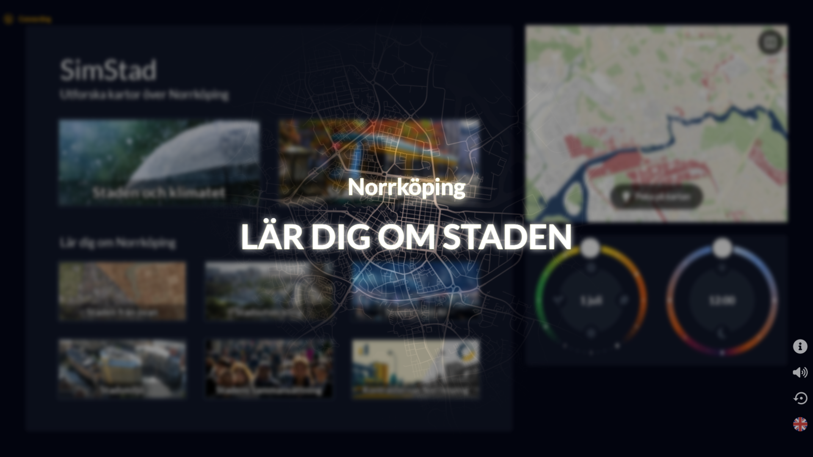

# SimStad Interface



The SimStad Interface is the Phaser-based touchscreen application for the
[SimStad exhibition](https://immvis.appvis.se/guides/simstad/). It is used to explore stories and control the exhibit as a visitor.

The Interface loads exhibition content from
[Omni](https://immvis.appvis.se/guides/simstad/omni/), sends commands to the
[Unreal Engine application](https://immvis.appvis.se/guides/simstad/unreal/),
and can control supplementary displays and audio through
[PIXILAB Blocks](https://immvis.appvis.se/guides/simstad/blocks/).

For installation, operation, and maintenance instructions, see the
**[complete Interface documentation](https://immvis.appvis.se/guides/simstad/interface/)**.


## Prerequisites

- [Node.js 18 or newer](https://nodejs.org/)
- A configured Omni instance with a City Exhibit and content
- A local copy of Omni's media folder, either on the same computer or
  [synchronized with Syncthing](https://immvis.appvis.se/guides/simstad/syncthing/)

The web version requires a current browser. The packaged Windows application
requires Microsoft Edge 89 or newer and
[WebView2](https://go.microsoft.com/fwlink/p/?LinkId=2124703). WebView2 is
included with Windows 11.

## Quick start

1. Clone the repository:

    ```sh
    git clone https://github.com/c-toolbox/SimStad-Interface.git
    cd SimStad-Interface
    ```

2. Install the dependencies:

    ```sh
    npm install
    ```

3. Configure `config.json` as described below.

4. Start the development server:

    ```sh
    npm run dev
    ```

5. Open the address printed by Vite and confirm that the expected collections
    and raster media appear.

Before testing the complete visitor experience, follow the
[Omni setup guide](https://immvis.appvis.se/guides/simstad/omni/) to create a
City Exhibit, Rasters, Scenarios, Collections, and localized strings.

## Configuration

The application reads `config.json` from the repository root at startup. A
minimal local-development configuration looks like this:

```json
{
  "MEDIA_PATH": "C:\\SimStad\\media",
  "BLOCKS_URL": "",
  "OMNI_URL": "http://localhost:8000",
  "OMNI_TOKEN": "YOUR_OMNI_CLIENT_TOKEN",
  "CITY_ID": "norrkoping",
  "IDLE_RASTER": "IdleMovie",
  "IDLE_TIME": 300,
  "IDLE_FADE": 10,
  "ONLINE": false
}
```

| Setting | Description |
| --- | --- |
| `MEDIA_PATH` | Absolute path to a complete local copy of Omni's media folder. Escape Windows backslashes as `\\` in JSON. |
| `BLOCKS_URL` | PIXILAB Blocks WebTask endpoint, normally ending in `/rest/script/invoke/WebTask`. Leave empty for local testing without Blocks. |
| `OMNI_URL` | Base URL of the Omni instance. Omni content is loaded even when `ONLINE` is `false`. |
| `OMNI_TOKEN` | `CLIENT_TOKEN` generated by the Omni Service for this installation. Do not use the Unreal application's host token. |
| `CITY_ID` | Key of the Omni City Exhibit whose content should be loaded. |
| `IDLE_RASTER` | Key of the Omni Raster shown in attraction mode. |
| `IDLE_TIME` | Seconds without interaction before the Interface resets. |
| `IDLE_FADE` | Fade-to-black duration in seconds before an idle reset. |
| `ONLINE` | Enables Blocks integration and WebSocket communication with Unreal when `true`. Keep `false` during isolated local development. |

Treat service tokens as credentials. Do not commit a production token to the
repository. Use separate Omni Services for development and the public
installation so local testing cannot affect the live exhibit.

## Build and deployment

Create the packaged Windows application with:

```sh
npm run build
```

The deployable application is written to `dist/win/simstad-interface`. Copy
that directory to the exhibition computer, review its `config.json`, and start
`SimStad Interface.exe`.

The build copies the root `config.json` into `dist`. The deployed application
will usually require a different `OMNI_TOKEN` and possibly different service
URLs and media path, so check the deployed copy before starting it.

The Interface reads raster images, videos, thumbnails, and other generated
media from `MEDIA_PATH`; API access does not transfer those files. Make sure
Syncthing has finished before testing changed exhibition content.
